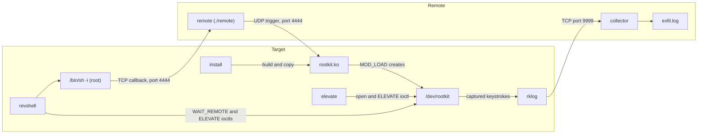
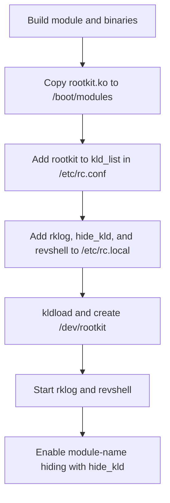
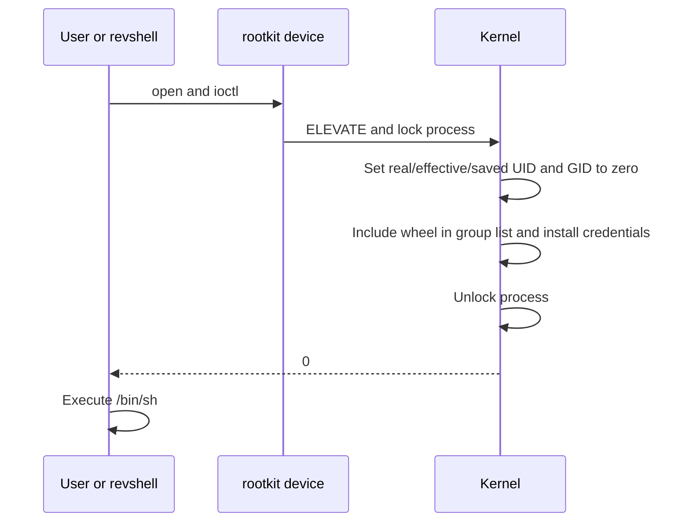
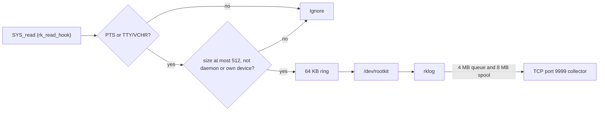
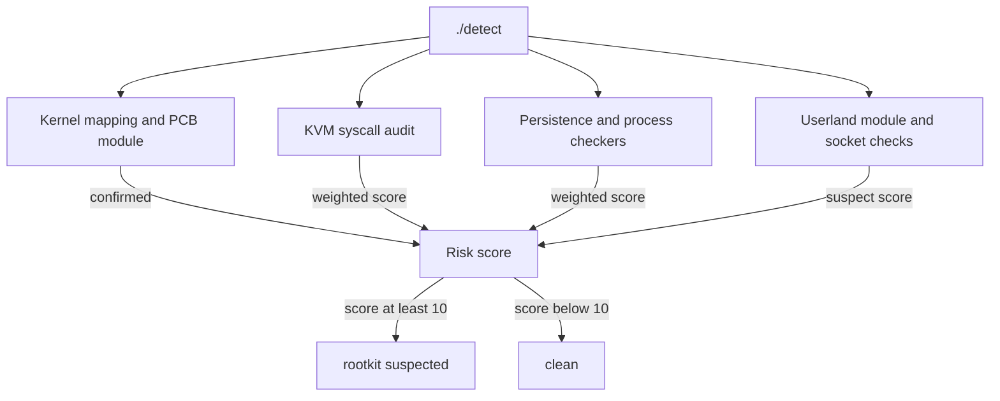

# FreeBSD 14.5 Rootkit & Detector

## 1. System architecture

## 2. Installation and persistence

- `./install` verifies dependencies and source paths, builds `kernel/rootkit.ko`, `elevate`, `revshell`, `remote`, and `rklog`; it installs `elevate`, `revshell`, and `rklog` as `/usr/local/bin/{elevate,revshell,rklog}`, and compiles `user/hide_kld.c` to `user/hide_kld` before installing it as `/usr/local/bin/hide_kld`.
- Persistence: `/boot/modules/rootkit.ko`, `kld_list+=rootkit` in `/etc/rc.conf`, `/usr/local/bin/rklog`, `/usr/local/bin/hide_kld`, and `/usr/local/bin/revshell &` in `/etc/rc.local`.
- `revshell` persistence was added after the midpoint.
- `/dev/rootkit` is recreated on `MOD_LOAD` as `root:wheel`, mode `0666`.
- Loading is performed last, after configuration writes, to prevent hiding hooks from blocking installation.
- `./uninstall` stops `rklog`/`revshell`, waits for `/dev/rootkit` references to leave, disables hiding, unloads the module, removes the module/binaries and `kld_list` entry, and removes `rklog`/`hide_kld` entries from `/etc/rc.local`; it does not remove the `revshell` startup line.

## 3. Privilege escalation

- `elevate` opens `/dev/rootkit` and issues `rootkit_ELEVATE`; `revshell` uses `rootkit_IOCTL_ELEVATE`, an alias for the same ioctl. The handler acquires `PROC_LOCK`, creates/copies a credential, sets real/effective/saved UID and GID to `0` (`GID_WHEEL`), includes `wheel` in the group list, and installs it on the calling process.
- `rootkit_WAIT_REMOTE` waits on `remote_cv` until the UDP listener records the sender address and signals the condition variable. `revshell` forks, elevates the child, calls `hide_process_syscall()`, connects TCP to the trigger host on port 4444, duplicates the socket onto descriptors 0/1/2, then calls `execve("/bin/sh", ...)`. If the trigger address is `0.0.0.0` (for example, QEMU forwarding), it uses the compiled `DEFAULT_REMOTE_IP` (default `10.0.2.2`).
- At startup, `revshell` retries opening `/dev/rootkit` once per second for up to 120 seconds, because the binary can start before `MOD_LOAD` creates the device.

## 4. Concealment

| Target | Intercept / structure | Detection-relevant mechanism |
|---|---|---|
| Directory listings | `SYS_getdirentries` and `SYS_freebsd11_getdirentries`; native/11.x dirent layouts | Call the original syscall; copy the returned buffer; walk `d_reclen`; remove names matching `rootkit`, `hide`, etc.; compact records and reduce the returned size. |
| Files/configuration | `SYS_fstatat`, `SYS_open`, `SYS_openat`, `SYS_access` | `fstatat` filters paths containing hidden-name substrings such as `rootkit` or `hide`. `open`, `openat`, and `access` return `ENOENT` only for exact matches in `blocked_files` (including `/etc/rc.conf`, `/etc/rc.local`, `/boot/modules/rootkit.ko`, and selected binaries); other paths are passed through. `/dev/rootkit` is not in `blocked_files`, so clients can open it. |
| Modules | `SYS_kldnext`, `SYS_kldfind`, `SYS_kldstat`, `SYS_modfind`, `SYS_modstat`; custom `sys/kld_hiding` | Resolve the module using `linker_file_foreach()` and filter its name/id at syscall boundaries. `hide_kld` enables filtering by name; `hide_kld -u` passes an empty name to `sys/kld_hiding`, disabling it so the module can be found and unloaded. Restore every original `sy_call` on unload. |
| TCP ports | Manually invoked custom syscall `sys/port_hiding`; `V_tcbinfo.ipi_listhead`, `ipi_count` | An external caller resolves and invokes the registered syscall; it is not run automatically. It locks `V_tcbinfo`, removes matching local/foreign-port TCP `inpcb` entries, and decrements `ipi_count`. It does not hide the UDP `:4444` trigger socket, which is in `V_udbinfo`. |
| Processes | Hidden-PID table; `SYS___sysctl`, `SYS_kill` | Record hidden PIDs in a mutex-protected table. Filter matching entries from `KERN_PROC` `sysctl` results and return `ESRCH` from hidden-PID `kill`. Live process structures and PID lists are not unlinked. |

## 5. Bonus capabilities

- **Keystroke capture:** hook `SYS_read`, run the real read first, and capture successful reads from `DTYPE_PTS` or TTY/VCHR vnodes. Exclude the rootkit cdev, `devd`, `syslogd`, `init`, leading `!` data, and reads above 512 bytes. Assemble lines with PID/UID headers in a 64 KB ring. `SYS_write` is also patched and restored by `rk_log_uninit()`; its optional stdout/stderr capture is disabled by default.
- **Delivery:** `rklog` polls `/dev/rootkit`, buffers 4 MB in RAM, spools 8 MB to `/var/log/.rklog.spool`, retries 500 ms–30 s, and sends TCP to port 9999. The collector accepts a peer, optionally enforces `-f <TARGET_IP>`, writes `exfil.log`, and rotates at 8 MB.
- **Remote shell:** a kernel UDP listener on port 4444 accepts the exact `BSD_rootkit_REMOTE_MAGIC_TRIGGER_v1` datagram, records the sender, and wakes `revshell`, which creates the elevated TCP callback.

## 6. Changes since midpoint

| Area | Midpoint → final |
|---|---|
| Modules | Replaced tentative list mutations with `kld*/mod*` syscall filtering using public `linker_file_foreach()`; added module-name and bare-name handling. |
| Processes | Replaced direct `allproc`/PID-hash unlinking with a mutex-protected hidden-PID table and `KERN_PROC`/`kill` syscall filtering to avoid corrupting live process bookkeeping. |
| Persistence | Moved loading after setup, hid configuration/module paths, and added post-midpoint persistent `revshell` startup. Removed the conflicting `hiding/` prototype that caused `EEXIST`. |
| Key capture | Added `DTYPE_PTS`, excluded noise processes and own cdev, capped reads, and removed key capture sysctl exposure. |
| Teardown | Added ordered daemon stop, hiding disable, unload, and file/persistence cleanup; removed successful-unload `dmesg` messages. |
| Installer | Reduced install output, removed redundant OS/root checks, and fixed the `hide_kld` build. |
| Detection | Added kernel mapping/PCB checks, KVM syscall audit, persistence/process/bookkeeping checkers, and unified scoring. |

## 7. Detector design and detected methods

| Method | What is detected | How it is checked |
|---|---|---|
| Executable mapping census | Hidden or unlinked KLD text / anonymous executable kernel mappings | On `sysctl kern.detector.scan=1`, call `linker_file_foreach()` to record claimed ranges, then use `vm_map_lock_read()` and `VM_MAP_ENTRY_FOREACH()` on `kernel_map`. Check `VM_PROT_EXECUTE` entries at least `PAGE_SIZE` long from the kernel image through a bounded 64 MB window above it; report executable mappings not overlapping the kernel image or any recorded linker-file range. |
| PCB counter audit | TCP PCB unlinking that leaves `ipi_count` stale | Compare `V_tcbinfo.ipi_count` with a full `INP_ALL_ITERATOR(..., INPLOOKUP_RLOCKPCB)` walk over 3 samples 100 ms apart; `ipi_count > reached list` on all samples is confirmed. This does not detect this rootkit's `port_hiding`, which decrements `ipi_count` to match the removed entries. |
| Syscall integrity | Patched `sysent[]` slots | `kvm_openfiles()`/`kvm_nlist()` resolve `sysent` and each original symbol. For syscall number `n`, read `sysent_base + n * sizeof(struct sysent)` and compare `sy_call` with the original symbol address. The 26 checked slots are `exit`, `getdirentries`, `fstatfs`, `__sysctl`, `__sysctlbyname`, `execve`, `fexecve`, `open`, `openat`, `read`, `write`, `ptrace`, `kldload`, `kldunload`, `kldstat`, `kldnext`, `setuid`, `seteuid`, `bind`, `accept`, `connect`, `recvfrom`, `recvmsg`, `fstatat`, `access`, and `kill`. |
| Persistence artifacts | Rootkit-named paths, binary strings and startup configuration | `persistence_detector` checks known paths including `/boot/modules/rootkit.ko`, `/boot/modules/hiding.ko`, `/usr/local/bin/revshell`, `/usr/local/bin/rklog`, `/dev/rootkit`, and `/etc/rootkit_remote_ip`; scans startup/config files including `/etc/rc.local`, `/etc/rc.conf`, `/etc/rc.conf.local`, and `/boot/loader.conf`, plus cron/periodic/rc directories. It strips comments and scores suspicious names, content, and paths. A high-confidence hit contributes 10 points (the verdict threshold). The observed `p:10` can come from `lstat()` existence checks on known suspicious paths such as `/usr/local/bin/revshell`; it does not require reading configuration or module paths blocked by rootkit hooks. |
| Cross-view/process audit | Disk/runtime/listing discrepancies, hidden processes and processless sockets | `detect.sh` compares `kld_list` entries and `.ko` files in `/boot/modules` or `/boot/kernel` against `kldstat -n/-m`, checks `kldstat -v` for loaded modules outside boot directories, and flags `sockstat -4` rows whose `USER` field is `?` (sockstat's placeholder for a socket without an owning process). `process_detector` compares process-list, per-PID query, signal, and file-table views and scores suspicious process names or inconsistent visibility. |

`./detect` adds confirmed findings at 10 points each and suspect findings at 1 point; persistence, process, and syscall checkers contribute their own weighted scores. The overall threshold is 10, and any checker reporting a finding at its own high-confidence threshold also makes the verdict positive.

Recorded FreeBSD 14.5 measurements (`kern.osreldate=1405000`):

| Scenario | Score / evidence | Verdict |
|---|---:|---|
| Clean host | 1 (`m:1`) | clean |
| Rootkit loaded, idle | 21 (`p:10`, `s:11`) | rootkit suspected |
| Rootkit loaded after remote shell | 23 (`p:10`, `pr:1`, `s:11`, `m:1`) | rootkit suspected |
| `hooktest.ko`, 16 KB unlinked executable mapping | confirmed mapping at `0xffffffff83000000` | confirmed |

Legend: `p` = persistence, `pr` = process, `s` = syscall hooks, `m` = module/socket bookkeeping suspect. The `m:1` contribution is a low-confidence userland finding, such as a `sockstat -4` row with `USER` set to `?` for a processless socket; its presence varied between runs with the observed sockets and does not itself establish compromise.

## 8. Design decisions and justification

### Rootkit

| Decision | Justification |
|---|---|
| Syscall-boundary hiding | Avoids undocumented static kernel structures and leaves kernel lists and module text intact. Original syscalls and all patched slots are restored on unload. |
| Hook `kld*` and `mod*` | Closes both module-list and bare-name lookup paths used by `kldstat -m`. |
| Filter process views instead of unlinking | Avoids corrupting `allproc`, PID-hash, lock order, and process-exit bookkeeping. |
| Decrement `ipi_count` when removing a TCP PCB | Keeps the table count consistent with the list and avoids stale-counter corruption; consequently, the detector's counter check does not flag this implementation. |
| Kernel capture; userland transport | Keeps ring/device handling in the kernel while isolating retries, DNS, and large spooling outside kernel memory. |
| TTY/PTY type filtering | Captures arbitrary SSH/`su` descriptors and excludes pipes/files; noise-process and size gates reduce ring flooding. |
| Load last; unhide before unload | Prevents hiding hooks from blocking setup or teardown. Daemons are stopped and allowed to exit before `destroy_dev()`; otherwise outstanding device references can make unload wait while holding the linker lock. |
| Retry `/dev/rootkit` for up to two minutes | `revshell` can be launched as startup progresses; retrying tolerates device-creation or startup-order races instead of exiting after one failed open. |
| No `kern.rootkit.*` sysctls or successful-unload banner | Avoids simple sysctl/dmesg string signatures; load failure diagnostics remain available. |
| Collector accepts peers by default | NAT and QEMU slirp can rewrite source addresses; optional `-f` strict matching is available when source-IP identity is reliable. |

### Detector

| Decision | Justification |
|---|---|
| Kernel module plus userland checkers | Userland enumeration can be filtered; kernel structure reads and libkvm preserve independent ground truth. |
| Execute scans on demand | `kernel_map` is write-locked during `MOD_LOAD`, so a scan there can deadlock `kldload`. |
| Match linker ranges before mapping census | Avoids false positives for normal live modules and provides lock-order consistency with module loads. The kernel ELF mapping begins about 2 MB below `linker_kernel_file->address`, which starts at text and whose `size` does not cover the full mapping; use overlap, not containment, to exclude the kernel image's ELF head. The scan is capped at 64 MB after the image to bound work to the expected KLD allocation area and avoid unrelated high KVA. |
| Treat mapped-module census as a limited signal | This rootkit filters module queries but leaves its `linker_file` entry intact, so its executable mapping is claimed and is not reported as unlinked code. |
| Compare PCB count to reachable list | Detects stale accounting after PCB unlinking; it does not flag this rootkit's `port_hiding`, which keeps `ipi_count` consistent. |
| Full PCB iterator and 3 samples | Safe SMR/lock-released traversal plus repeated samples avoids transient connection-race false positives. |
| Confirmed/suspect scoring with threshold 10 | Ground-truth findings can convict confidently; heuristics remain capped below the threshold rather than being self-contradictory. |
